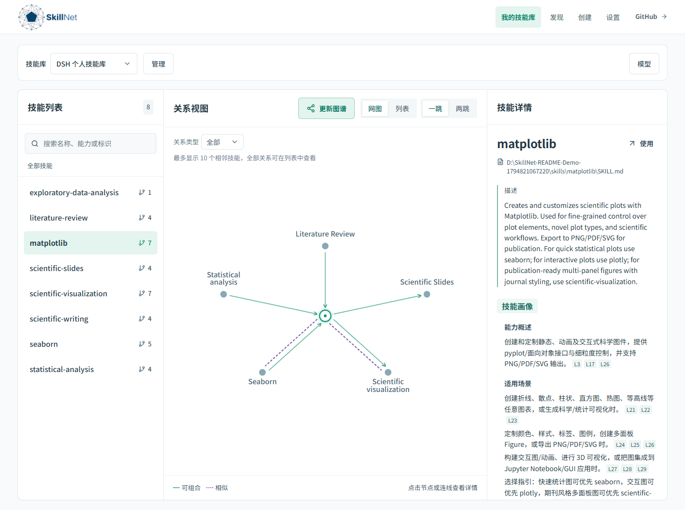
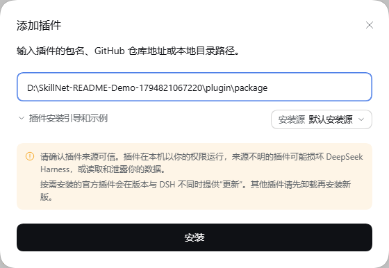
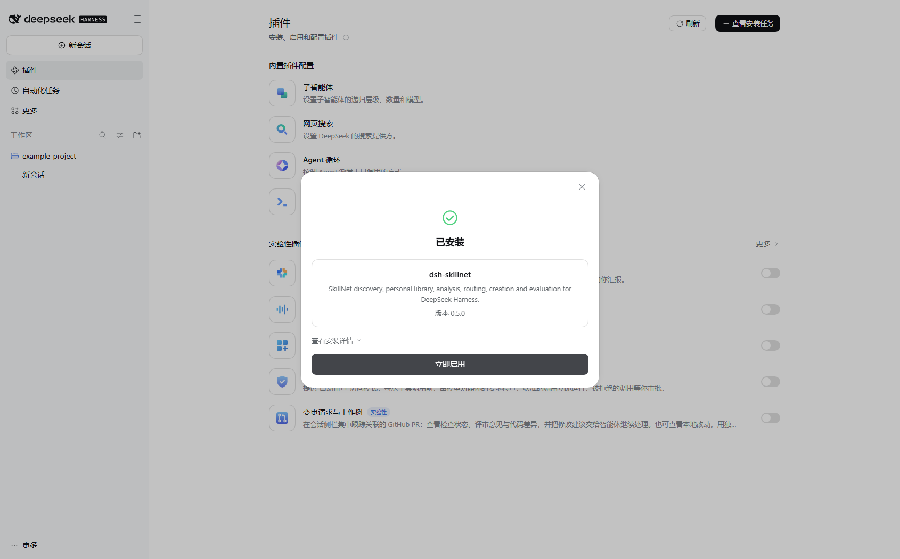
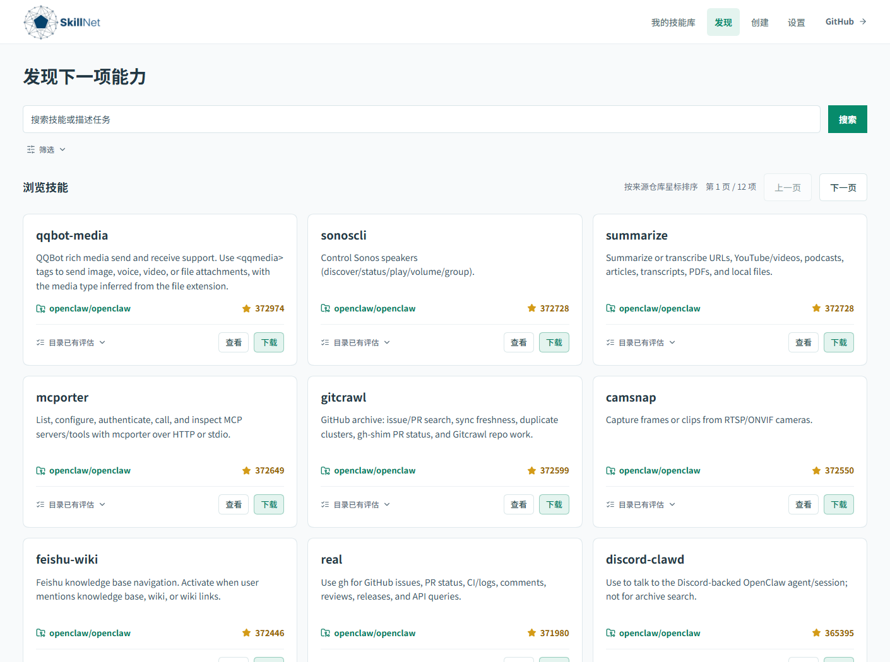
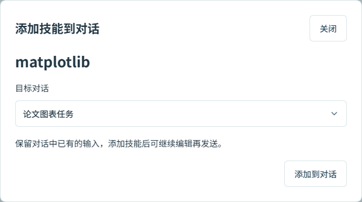
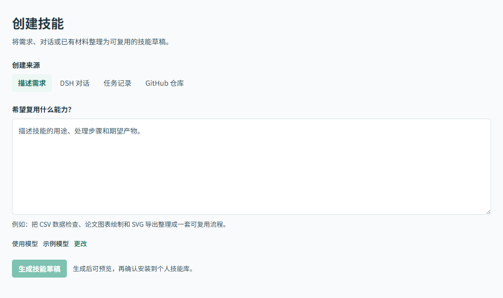
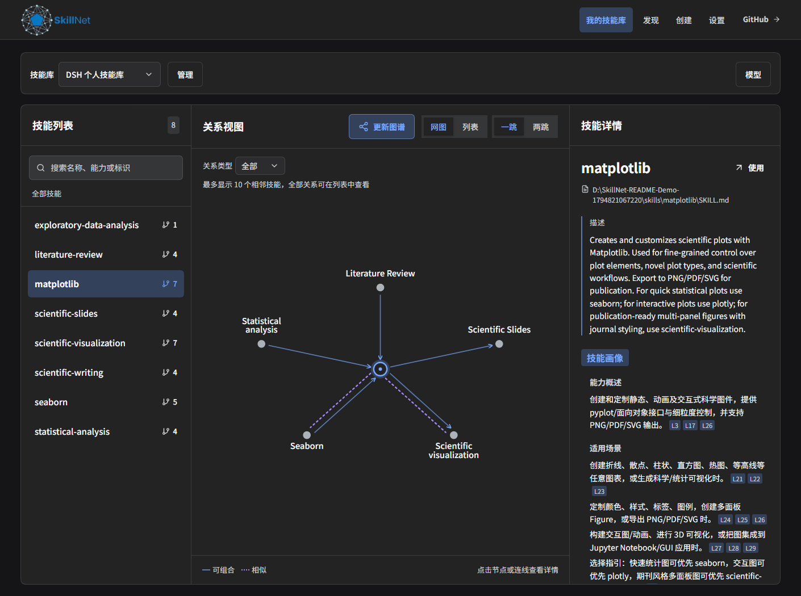

# SkillNet DSH

[SkillNet](https://github.com/zjunlp/SkillNet) 的 [DeepSeek Harness](https://github.com/deepseek-ai/deepseek-harness) 插件，在 DSH 中发现、安装、使用和分析技能。

中文界面沿用 SkillNet 三栏技能库与关系网图，跟随 DSH 明暗主题。默认使用 DSH 当前或选定模型。建图和检索基于 SkillNet SDK。

当前源码适配 **DSH 0.2.2-rc.1** 和 **0.2.2-rc.5**，后端固定 **skillnet-ai==0.1.5**。已发布的 **v0.5.0** 安装包适配 **DSH 0.2.2-rc.1**。

[快速安装](#安装) / [第一次使用](#使用) / [常见问题](#常见问题) / [下载发布包](https://github.com/TengJiao33/skillnet-dsh/releases/tag/v0.5.0)



截图来自插件在 DSH 中运行的隔离示例库，模型栏为演示配置。示例库使用 [K-Dense 的公开技能](https://github.com/K-Dense-AI/scientific-agent-skills)。

## 功能

| 功能 | 行为 |
| --- | --- |
| 我的技能库 | 浏览描述、源码、画像、关系与证据。可在工作台打开任务匹配和建图记录 |
| 发现与安装 | 搜索 SkillNet 目录，查看来源和完整技能包；校验后安装到选定的技能库 |
| 安装管理 | 检查已安装技能的更新，预览差异后确认。可卸载并恢复由插件管理的安装 |
| 使用技能 | 选择目标 DSH 对话，在原草稿后追加原生技能引用，不自动发送 |
| 对话内路由 | 在普通聊天里按库名、自动选库或跨库匹配。可以只看推荐，也可以加载技能并继续执行 |
| 建图 / 更新图谱 | 检查变化后启动可取消的后台作业，使用 DSH 模型提取画像并复核关系 |
| 创建技能 | 从需求、DSH 对话、任务记录或 GitHub 仓库生成草稿，预览后确认安装 |
| 质量评估 | 确认后完成官方五维评估，最近一次成功结果常驻对应技能详情 |

建图和路由支持无向量配置运行。建图的自动模式在向量配置完整时使用原 SDK，路由的自动模式在向量索引匹配且最新时使用原 SDK。显式向量模式失败时会显示错误。

## 安装

安装 **v0.5.0** 可直接使用发布包，包中已包含前端构建产物。要使用当前源码中的工作台、安装管理和对话路由功能，或使用 **DSH 0.2.2-rc.5**，请按下方的「从源码安装 / 开发」操作。

### 1. 准备 DSH 和 Python

| 依赖 | 要求 |
| --- | --- |
| DSH | **0.2.2-rc.1**、**0.2.2-rc.5** |
| Python | **3.10+**，建议使用已验证的 **3.12**；[官方下载](https://www.python.org/downloads/) |
| Node.js | 用 `npx` 启动 DSH 或从源码构建时需要 **22.19+**；[官方下载](https://nodejs.org/en/download) |
| Git | 仅“从源码安装”需要 |

已有 DSH 桌面版可直接使用。没有桌面版时，可以按 [DSH 官方运行说明](https://github.com/deepseek-ai/deepseek-harness#run)，用下面的固定版本启动 Web 界面：

```sh
npx @deepseek-ai/dsh@0.2.2-rc.1 web
```

首次进入 DSH，按宿主引导登录 DeepSeek 或配置自己的模型 API Key。SkillNet 默认复用 DSH 的模型，不需要再配置另一套分析模型密钥；插件的技能浏览和下载本身不调用模型。

### 2. 下载发布包并安装 Python 依赖

**Windows / PowerShell**：确认 `python --version` 能显示 Python 3.10 或以上，然后复制执行：

```powershell
$installRoot = Join-Path $HOME "tools\skillnet-dsh-0.5.0"
New-Item -ItemType Directory -Force $installRoot | Out-Null
Set-Location $installRoot

Invoke-WebRequest -Uri "https://github.com/TengJiao33/skillnet-dsh/releases/download/v0.5.0/dsh-skillnet-0.5.0.tgz" -OutFile "dsh-skillnet-0.5.0.tgz"
tar -xzf .\dsh-skillnet-0.5.0.tgz
Set-Location .\package

python -m venv .venv
& .\.venv\Scripts\python.exe -m pip install -r requirements.txt
& .\.venv\Scripts\python.exe -c "from importlib.metadata import version; print(version('skillnet-ai'))"

(Get-Location).Path
```

版本检查应输出 **`0.1.5`**。最后一行会打印插件目录的绝对路径，下一步要粘贴这个路径，例如：

```text
C:\Users\你的用户名\tools\skillnet-dsh-0.5.0\package
```

无需激活虚拟环境：上述命令直接使用 `.venv` 中的 Python。首次安装 Python 依赖可能需要一些时间，等待 `pip install` 成功结束后再添加插件。

<details>
<summary>macOS / Linux 对应命令</summary>

```bash
mkdir -p "$HOME/tools/skillnet-dsh-0.5.0"
cd "$HOME/tools/skillnet-dsh-0.5.0"
curl -fL "https://github.com/TengJiao33/skillnet-dsh/releases/download/v0.5.0/dsh-skillnet-0.5.0.tgz" -o dsh-skillnet-0.5.0.tgz
tar -xzf dsh-skillnet-0.5.0.tgz
cd package

python3 -m venv .venv
./.venv/bin/python -m pip install -r requirements.txt
./.venv/bin/python -c "from importlib.metadata import version; print(version('skillnet-ai'))"
pwd
```

最后输出的目录用于下一步。Windows 安装流程已在 DSH 原生界面核对；以上为其他系统的对应命令。

</details>

### 3. 在 DSH 中安装并启用

1. 打开 DSH 左侧的 **插件**，点击右上角 **添加插件**。
2. 在输入框粘贴上一步得到的**插件目录绝对路径**，点击 **安装**。这里填的是包含 `package.json` 的 `package` 目录，不是它的上级目录。
3. 安装完成后，点击 **立即启用**。
4. 刷新 DSH 界面；桌面版如仍未出现入口，重新打开 DSH。



<details>
<summary>查看安装完成后的“立即启用”界面</summary>



</details>

### 4. 确认安装成功

左侧出现 **SkillNet** 后，点击打开，应能看到 **我的技能库 / 发现 / 创建 / 设置** 四个入口。

首次打开会连接个人技能目录 `~/.dsh/skills`；设置了 `DSH_HOME` 时使用该目录下的 `skills`。新用户的列表为空是正常的，按下文从“发现”安装第一个技能即可。

到这里就可以浏览、下载和使用技能，**不必先建图，也不必配置向量模型**。

<details>
<summary>从源码安装 / 开发</summary>

准备 Git、Node.js 22.19+ 和 Python 3.10+，执行：

```powershell
git clone https://github.com/TengJiao33/skillnet-dsh.git
cd skillnet-dsh
python -m venv .venv
& .\.venv\Scripts\python.exe -m pip install -r requirements.txt
npm ci
npm run build
(Get-Location).Path
```

把最后输出的仓库路径，按第 3 步添加到 DSH。macOS / Linux 使用 `python3 -m venv .venv` 和 `./.venv/bin/python -m pip install -r requirements.txt`。

修改前端后需重新执行 `npm run build`。插件按以下顺序寻找 Python：插件配置 `python` → 环境变量 `DSH_SKILLNET_PYTHON` → 插件目录 `.venv` → 系统 `python`。

</details>

## 使用

### 第一次：搜索、安装，再添加到对话

1. 进入 **发现**，浏览技能，或输入 `pdf`、`matplotlib` 等技能名后点击 **搜索**。
2. 查看卡片上的描述、来源仓库和星标，点击 **查看** 检查技能包内容。
3. 选定后点击 **下载**。通过结构校验后，在弹窗中确认目标库并点击 **确认安装**。
4. 回到 **我的技能库**，选择刚安装的技能。新技能显示“未分析”也可以直接使用。
5. 先在 DSH 新建或打开一个目标对话，再回到技能详情点击 **使用**。
6. 选择目标对话，点击 **添加到对话**。插件会跳转过去并在输入框追加原生技能引用；继续写任务，再由你发送。



“添加到对话”保留已有草稿、附件和技能引用，不自动发送消息或启动模型。



### 个人技能库

首次打开自动连接个人技能目录，规则为：显式配置的 `dshHome` → `DSH_HOME` → 当前用户 `~/.dsh`，再取 `skills` 子目录，与 DSH 软件安装位置无关。

技能包应直接位于 `skills/<技能名>/SKILL.md`。通过技能库的 **管理 → 新建技能库** 创建独立库，之后用左上角的下拉框切换。新库保存在 `DSH_HOME/skillnet/libraries/<库名>/skills`，支持中文库名。下载技能和发布草稿时，可在默认个人库和已连接的独立库之间选择。

独立库支持浏览、建图和检索。要在 DSH 对话里调用独立库中的技能，可以从技能详情点击 **添加到对话**，按提示安装到 DSH 个人技能库。也可在 **管理** 中连接已有目录。

列表、描述和普通源码视图读取当前文件。已有画像和图谱会保留，技能增删不会清空旧图谱；证据点击后打开分析时保存的源码快照并定位行号。零关系时仍显示技能节点。

在工作台点击 **任务匹配**，可先为当前库生成名单，再把任务和选中的技能添加到指定对话的草稿。建图进度和结果可在 **建图记录** 中查看。

### 发现、下载与使用

在“发现”浏览或搜索技能，默认按来源仓库星标排序。点击“查看”打开完整技能包；点击“下载”读取、校验后，由用户确认安装。

搜索使用 SkillNet 托管目录，结果可能指向历史提交，不等于对 GitHub 当前主分支的实时核验。下载保留来源指定版本，不擅自换成最新版。星标属于来源仓库；目录已有评估会标明来源。

浏览和搜索结果会检查来源指定版本的 `SKILL.md`，隐藏确认不存在的条目；超时、限流等暂时无法确认的情况保留结果。检查结果缓存 5 分钟，完整技能包仍在下载时校验。

在技能详情点击“使用”，选择目标对话后追加原生 `/技能名` 引用。保留已有文字、附件和引用，由用户继续编辑或发送，不调用模型。

插件管理的安装可从技能详情 **检查更新**，预览差异后选择 **备份并确认更新**。卸载后的技能可在 **管理 → 已移除技能** 中恢复。

### 对话内路由

直接在 DSH 对话里描述任务，无需填写工具名、库 ID 或 JSON。

- 「用报表分析库检查这份 CSV，再做一个按地区筛选的看板。先只推荐，最多五项。」
- 「用学术绘图库画作者合作网络，计算中心性，并写一段替代文本。现在开始。」
- 「请同时用报表分析库和公众号运营库，先检查销售明细，再把汇报文稿排成微信 HTML。」

未点名库时，插件会根据任务匹配一个库，无法确定时请用户确认。只推荐时可选到尚未安装的技能。同一条用户消息里再次匹配相同范围，会沿用已有名单。

执行时，助手通过 DSH 原生技能工具加载所选指令。缺少安装时，可在工作台安装所需技能，再回到原对话说「继续」。先看推荐再要求执行，也会沿用原名单。

自动路由优先使用与当前配置匹配且最新的向量索引，其他情况从当前技能源码选技。路由优先使用当前模型支持的 Low 或 Off 档位。路由无需先打开插件页，也不自动下载或创建技能。

### 建图与更新

点击“建图 / 更新图谱”后，插件会检查源码、模型和建图配置。有变化时启动后台作业，可在技能库查看当前阶段、结果或取消作业。配置与源码和已有图谱一致时，直接提示“图谱已是最新”。

- 建图从一次 DSH 推理预热，稳定后最高四并发。遇到限流会退避、减半并发，连续成功八次后逐级恢复。结构和证据校验失败时，当前推理会带着反馈纠正一次。
- 新生成的技能画像、场景和关系说明使用简体中文。重新建图可复用已校验的画像、向量与关系判断。
- 画像校验失败的技能会列为待补。用已通过的画像建图，待补关系少于精核候选的 5% 时发布快照。再次建图会复用已有画像与关系，重新生成候选并补齐缺项。中途停止会保留旧图谱和成功缓存。源码改变或已有更新快照发布时，当前作业会提示重新建图。

向量模式使用 SkillNet SDK 提取候选并发布向量索引。按模型和源码复用已有画像与关系判断，新候选直接结合画像和源码复核。DSH 画像与关系复核优先使用 Low，其次 Off，再回退到所选模型的默认档位。仅使用模型模式对小库直接比较技能对，较大库用 BM25 和显式引用筛选候选。此前已准备的建图对话仍可继续。

### 创建与评估

“创建”支持描述需求、导入文档、参考 DSH 对话、复用任务记录和 GitHub 来源。导入的 Markdown、TXT、Word 或 PDF 会先提取为可编辑文本。生成期间可查看进度或取消，完成后可预览并确认安装。

例如，选择“描述需求”，写明想复用的用途、处理步骤和期望产物，点击 **生成技能草稿**。完成后点击卡片上的 **查看草稿**，检查内容，再在预览窗口确认安装。



对话来源只读取最近 24 条用户 / 助手文本，最多 80,000 字符，不提取系统提示、工具结果或推理。读取本身不调用模型。

“质量评估”检查安全性、完整性、可执行性、成本意识和可维护性，并保留 SDK 提示注入扫描。成功结果按技能和目录保存；重评时保留原结果，新评估成功后替换，失败或取消不清除旧结果。结构校验与图谱分析不代表技能质量已通过评估。

<details>
<summary>查看深色主题</summary>



</details>

## 常见问题

**安装完成了，但没有 SkillNet 入口？** 先确认已点击“立即启用”，再刷新当前 DSH 界面或重新打开桌面版。安装和使用应在同一个 DSH 界面 / profile 中完成。

**提示无法启动 Python 后端或缺少 skillnet-ai？** 进入添加给 DSH 的插件目录，确认其中有 `package.json`、`requirements.txt`、`src/`、`python/` 和 `.venv/`，再运行第 2 步的 SDK 版本检查。不要只在另一个 Python 环境里安装依赖。自定义解释器可通过插件配置 `python` 或 `DSH_SKILLNET_PYTHON` 指定。

**PowerShell 找不到 python 或 tar？** 先安装 Python 并重新打开终端；如果 Python 启动器可用，也可用 `py -3 -m venv .venv` 创建环境。没有 `tar` 时可用解压工具展开 `.tgz`，进入包含 `package.json` 的目录，再执行 Python 环境准备步骤。

**“我的技能库”为空，或没有关系图？** 本地目录初始为空时，先到“发现”安装技能。图谱需要另行点击“建图”生成；技能加载和默认路由不依赖图谱。默认目录结构是 `skills/<技能名>/SKILL.md`。

**搜索超时，或目录里的技能下载失败？** 搜索和下载分别依赖 SkillNet 目录服务与 GitHub。可稍后重试，或切换“关键词”检索并使用具体技能名；目录结果可能指向历史提交或已经失效的来源路径。

**如何更新？** 将新版本解压到另一个目录，准备好该版本的 Python 环境，再在 DSH“插件”中卸载旧插件、添加新目录并启用。个人技能与分析记录保存在 `DSH_HOME`，不在插件安装目录中。

## 模型与配置

默认使用 DSH 当前 / 选定模型，无需再填写一套分析模型密钥。“设置”保留高级独立 API 和可选向量配置。

- 后台建图使用确认时选定的 DSH 模型。技能库显示作业进度、失败原因和结果。
- 路由、创建、评估及查询改写使用 DSH 受限原生推理任务，继承模型选择，不继承原对话全部上下文或工具权限。
- 高级独立路由接口需要支持 DeepSeek Messages；任意 Chat Completions 网关不能直接替代。
- 向量模式单独要求向量模型配置，向量路由还要求有效且匹配当前技能的索引。

密钥通过 DSH 凭据服务保存，前端不回显。非敏感设置保存于 `DSH_HOME/skillnet/settings.json`。本仓库不包含预配置账号、密钥、个人技能或本机 profile。

## 数据位置

| 内容 | 默认位置 |
| --- | --- |
| 个人技能 | `DSH_HOME/skills/` |
| 连接和非敏感设置 | `DSH_HOME/skillnet/workspace.json`、`settings.json` |
| 建图 / 创建 / 评估任务与结果 | `DSH_HOME/skillnet/tasks/`、`results/`、`artifacts/` |
| 旧版建图对话进度 | `DSH_HOME/skillnet/analysis-conversations/` |
| 预览和安装记录 | `DSH_HOME/skillnet/staging/`、`installations/` |
| 分析快照与成功缓存 | 默认技能目录下的 `.skillnet/` |

断开目录连接或卸载插件不会删除技能和已保存分析。

## 开发与验证

先准备 Python 依赖，再运行：

```powershell
npm ci
npm run typecheck
npm run build
npm run check
npm test
```

自动化测试覆盖缓存与快照发布、建图更新、来源校验、路由的选库与加载、进程复用、安装管理和评估记录。模型接口测试使用受控响应。

`client/` 为前端源码，`npm run build` 生成 `src/panel.js`；共享 DSH 的 React，通过原生槽位加载，无需 iframe 或单独启动 SkillNet Web 服务。`python/` 为固定 SDK 版本的适配层，`src/` 为宿主服务和工具入口。

## 来源与许可

- 上游：[zjunlp/SkillNet](https://github.com/zjunlp/SkillNet)，前端来源版本见 [`client/upstream/UPSTREAM.json`](client/upstream/UPSTREAM.json)。
- 保留上游 MIT 许可与适配说明，见 [`LICENSE`](LICENSE) 和 [`NOTICE`](NOTICE)。
- 图标使用 Lucide，相关许可见 `NOTICE`。
